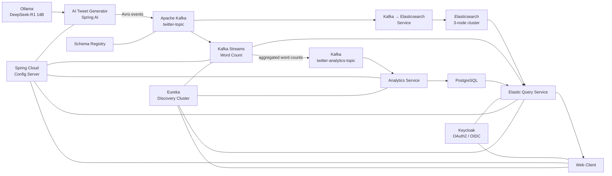

# AI Tweet Kafka Streaming

A distributed, event-driven microservices project that generates synthetic tweets with a local LLM, streams them through Apache Kafka, processes real-time word analytics with Kafka Streams, indexes documents in Elasticsearch, and exposes secured query services backed by Elasticsearch and PostgreSQL.

The project demonstrates a complete streaming pipeline built with **Java, Spring Boot, Spring AI, Apache Kafka, Avro, Kafka Streams, Elasticsearch, PostgreSQL, Spring Cloud, Eureka, Keycloak, Docker Compose, and Ollama**.

## Architecture



## How it works

1. **`ai-generated-tweet-to-kafka-service`** periodically asks a local Ollama model to generate tweet-like JSON containing configured technology keywords.
2. The generated event is serialized with **Apache Avro** and published to the **`twitter-topic`** Kafka topic.
3. **`kafka-to-elastic-service`** consumes tweet events and indexes them in Elasticsearch.
4. **`kafka-streams-service`** consumes the same stream, tokenizes tweet text, groups words, and maintains real-time word counts in a Kafka Streams state store.
5. Aggregated statistics are published to **`twitter-analytics-topic`**.
6. **`analytics-service`** consumes the analytics stream and persists the aggregated data in PostgreSQL.
7. **`elastic-query-service`** exposes secured REST endpoints for querying indexed tweets and analytics.
8. **`elastic-query-web-client`** provides a web interface protected with Keycloak authentication.

The application uses **Spring Cloud Config** for centralized configuration and a two-node **Eureka** setup for service discovery.

## Tech stack

| Area | Technology |
| --- | --- |
| Language | Java 25 |
| Backend | Spring Boot 4 |
| AI integration | Spring AI |
| Local LLM runtime | Ollama |
| Default model | DeepSeek-R1 14B |
| Messaging | Apache Kafka |
| Stream processing | Kafka Streams |
| Serialization | Apache Avro |
| Schema management | Confluent Schema Registry |
| Search / document storage | Elasticsearch |
| Relational storage | PostgreSQL |
| Service discovery | Netflix Eureka |
| Centralized configuration | Spring Cloud Config |
| Security | Spring Security, OAuth2/OIDC, Keycloak |
| API documentation | OpenAPI / Swagger |
| Containerization | Docker, Docker Compose |
| Build | Maven |

## Main modules

| Module | Responsibility |
| --- | --- |
| `ai-generated-tweet-to-kafka-service` | Generates synthetic tweets using Spring AI + Ollama and publishes them to Kafka |
| `kafka-streams-service` | Performs real-time word-count aggregation using Kafka Streams |
| `kafka-to-elastic-service` | Consumes tweet events and indexes them in Elasticsearch |
| `analytics-service` | Persists aggregated word analytics in PostgreSQL |
| `elastic-query-service` | REST API for tweet search and analytics queries |
| `elastic-query-web-client` | Secured web client for querying the system |
| `config-server` | Centralized Spring Cloud configuration |
| `config-server-repository` | Configuration files used by Config Server |
| `discovery-service` | Eureka service discovery nodes |
| `kafka` | Shared Kafka producer/admin/model modules |
| `elastic` | Shared Elasticsearch models, configuration and clients |
| `common-config` | Reusable configuration code |
| `common-util` | Shared utilities |
| `app-config-data` | Shared typed application configuration |

## Kafka pipeline

The default Kafka configuration uses two application topics:

```text
twitter-topic
    |
    +--> kafka-to-elastic-service --> Elasticsearch
    |
    +--> kafka-streams-service
              |
              +--> local Kafka Streams state store
              |
              +--> twitter-analytics-topic
                         |
                         +--> analytics-service --> PostgreSQL
```

The Kafka cluster is configured with **3 brokers** running in KRaft mode. Application topics use 3 partitions and a replication factor of 3.

## AI tweet generation

The generator uses Spring AI with Ollama. By default it is configured to use:

```text
deepseek-r1:14b
```

Tweets are generated periodically using keywords such as:

```text
Java
Microservices
Spring
Kafka
Elasticsearch
```

The generation prompt and scheduler interval can be changed in:

```text
config-server-repository/ai-generated-tweet-to-kafka-service.yaml
```

## Prerequisites

Before running the complete stack, install:

- Java 25
- Docker and Docker Compose
- Git
- Ollama
- Maven, or use the included Maven Wrapper

Pull the configured model:

```bash
ollama pull deepseek-r1:14b
```

Make sure Ollama is running on:

```text
http://localhost:11434
```

Docker containers access the host Ollama instance through `host.docker.internal`.

## Getting started

### 1. Clone the repository

```bash
git clone https://github.com/blackspyek/ai-tweet-kafka-streaming.git
cd ai-tweet-kafka-streaming
```

### 2. Start Ollama

```bash
ollama serve
```

If Ollama is already running as a background service, this step can be skipped.

### 3. Build the project and service images

Linux / macOS:

```bash
./mvnw clean install -DskipTests
```

Windows:

```powershell
.\mvnw.cmd clean install -DskipTests
```

The executable Spring Boot modules use the Spring Boot Maven plugin to create container images during the Maven `install` phase.

### 4. Configure development environment variables

Docker Compose configuration is located in:

```text
docker-compose/
```

The Compose setup expects variables for components such as Kafka, Elasticsearch, PostgreSQL, Config Server encryption, and Keycloak client credentials.

For a public repository, keep real credentials outside Git and use a local `.env` created from an `.env.example` template.

### 5. Configure Keycloak

The system expects a Keycloak realm named:

```text
microservices-realm
```

The main OAuth2 clients are:

```text
elastic-query-web-client
elastic-query-service
```

Configure the clients in Keycloak and provide the matching client secret through environment variables.

Development Keycloak is exposed at:

```text
http://localhost:9091
```

### 6. Start the distributed stack

```bash
cd docker-compose
docker compose up -d
```

The local `.env` defines the Compose files that form the complete environment:

```text
common.yaml
kafka_cluster.yaml
services.yaml
elastic_cluster.yaml
keycloak_authorization_server.yaml
```

Check container status:

```bash
docker compose ps
```

Follow logs:

```bash
docker compose logs -f
```

Stop the environment:

```bash
docker compose down
```

To also remove persistent Docker volumes:

```bash
docker compose down -v
```

## Useful local endpoints

| Service | URL |
| --- | --- |
| Web client | `http://localhost:8184/elastic-query-web-client` |
| Elasticsearch | `http://localhost:9200` |
| Schema Registry | `http://localhost:8081` |
| Config Server | `http://localhost:8888` |
| Eureka node 1 | `http://localhost:8761` |
| Eureka node 2 | `http://localhost:8762` |
| Keycloak | `http://localhost:9091` |
| Kafka broker 1 | `localhost:9092` |
| Kafka broker 2 | `localhost:9094` |
| Kafka broker 3 | `localhost:9095` |
| Kafka Streams Service | `http://localhost:8187/kafka-streams-service` |
| Analytics Service | `http://localhost:8188/analytics-service` |

## Example analytics endpoint

Kafka Streams exposes a word-count endpoint:

```http
GET /kafka-streams-service/get-word-count-by-word/{word}
```

The analytics service exposes persisted word statistics:

```http
GET /analytics-service/get-word-count-by-word/{word}
```

For example:

```text
Java -> count
Kafka -> count
Spring -> count
```

The query layer can use either the Kafka Streams state store or the analytics database depending on application configuration.

## Configuration

Centralized service configuration is stored in:

```text
config-server-repository/
```

Examples include:

```text
ai-generated-tweet-to-kafka-service.yaml
analytics-service.yaml
elastic-query-service.yaml
elastic-query-web-client.yaml
kafka-streams-service.yaml
```

Runtime values can also be overridden with Docker environment variables.

## Project structure

```text
.
├── ai-generated-tweet-to-kafka-service
├── analytics-service
├── app-config-data
├── common-config
├── common-util
├── config-server
├── config-server-repository
├── discovery-service
├── docker-compose
├── elastic
│   ├── elastic-config
│   ├── elastic-index-client
│   ├── elastic-model
│   └── elastic-query-client
├── elastic-query-service
├── elastic-query-web-client
├── kafka
├── kafka-streams-service
├── kafka-to-elastic-service
└── pom.xml
```

## What this project demonstrates

This repository is focused on practical distributed-systems concepts:

- event-driven microservice architecture
- asynchronous communication with Kafka
- Kafka producer and consumer configuration
- Avro serialization and Schema Registry
- replicated Kafka cluster configuration
- stateful stream processing with Kafka Streams
- materialized state stores
- real-time aggregation pipelines
- Elasticsearch indexing and querying
- persistence of analytical data in PostgreSQL
- centralized configuration with Spring Cloud Config
- service discovery with Eureka
- OAuth2/OIDC authentication and authorization with Keycloak
- local LLM integration through Spring AI and Ollama
- multi-container orchestration with Docker Compose

## Development notes

This project is intended as a development and learning environment. The Docker configuration contains development-oriented defaults and should be hardened before any production deployment.

In particular:

- do not commit real client secrets or passwords,
- disable default development credentials,
- enable Elasticsearch security where appropriate,
- use a proper secrets manager for production credentials,
- configure TLS for external communication,
- review Kafka security and authentication settings before exposing the cluster
